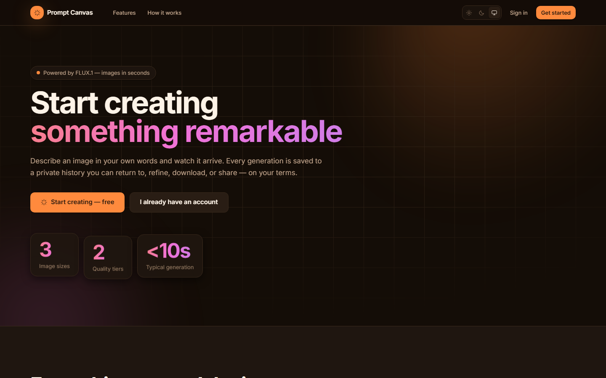
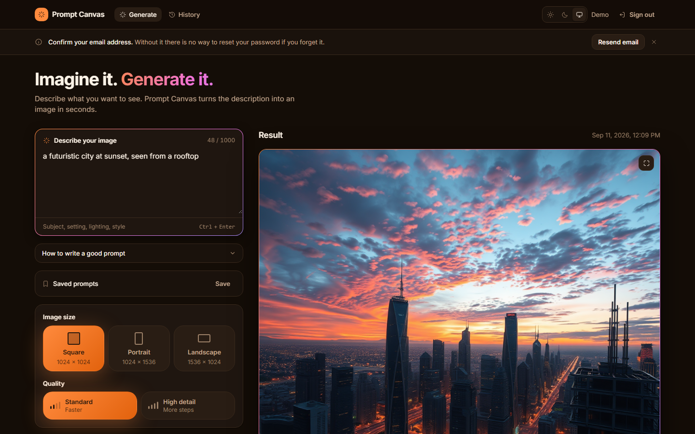
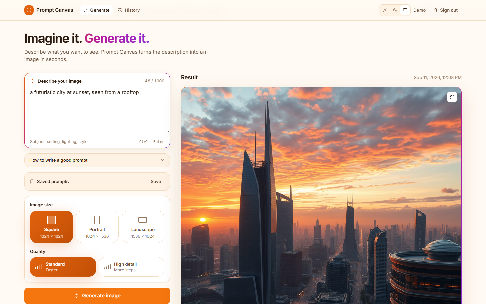
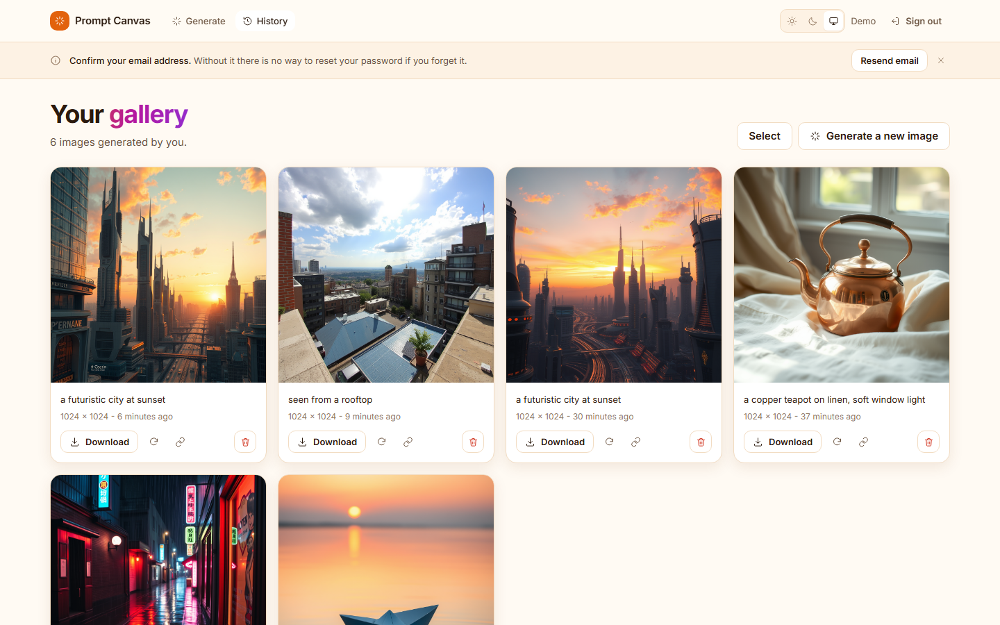

# Prompt Canvas

Describe an image in plain language and get it back in seconds. Every
generation is saved to a private history you can return to, refine, download,
or share on your own terms.

React 19 on the front, Django 6 and DRF on the back, images from Hugging Face
Inference Providers — with the provider credential held entirely server-side.



---

## Contents

- [What it does](#what-it-does)
- [Screenshots](#screenshots)
- [Stack](#stack)
- [Running it locally](#running-it-locally)
- [Using real AI images](#using-real-ai-images)
- [Tests](#tests)
- [Project layout](#project-layout)
- [API](#api)
- [How it is put together](#how-it-is-put-together)
- [Deployment](#deployment)

---

## What it does

- **Generate** from a text prompt, in three sizes and two quality tiers
- **Private history** — every image saved with its prompt and settings, visible
  only to the account that made it
- **Saved prompts** — keep a prompt that worked, with its size and quality, and
  restore the whole setup in one click
- **Share links** that expire and can be revoked, with a public read-only page
- **Bulk actions** — multi-select delete across the gallery
- **Visible quota** so you know what is left before you hit a limit
- **Accounts** with password reset and email confirmation
- **Dark and light themes**, full keyboard access, reduced-motion support

---

## Screenshots

### The generator

Prompt composer, visual size and quality pickers, and the result beside them.

| Dark | Light |
|---|---|
|  |  |

### The gallery

Everything you have made, with download, regenerate, share, and delete.

| Dark | Light |
|---|---|
|  |  |

---

## Stack

| Layer | Choice |
|---|---|
| Frontend | React 19, Vite 8, Tailwind CSS v4, React Router 7 |
| Backend | Django 6.1, Django REST Framework 3.18, SimpleJWT |
| Database | PostgreSQL in production, SQLite for local work |
| Images | Hugging Face Inference Providers (FLUX.1-schnell by default) |
| Storage | Filesystem behind a swappable interface |
| Tests | pytest, Vitest, Playwright |
| CI/CD | GitHub Actions |

---

## Running it locally

### What you need

| Tool | Version | Notes |
|---|---|---|
| Python | 3.12 or newer | `python --version` |
| Node.js | 20 or newer | `node --version` |
| PostgreSQL | 14 or newer | **Optional** — see below |

You do **not** need PostgreSQL to try the project. The setup below uses SQLite,
which needs no server and no configuration. Switching to PostgreSQL is one line
in `.env` when you want it.

You also do **not** need a Hugging Face account to start. The app ships with an
offline provider that produces placeholder images, and every other feature —
history, download, sharing, delete — behaves identically.

### 1. Get the code

```bash
git clone https://github.com/YOUR_USER/prompt-canvas.git
cd prompt-canvas
```

### 2. Backend

```bash
cd backend
python -m venv .venv
```

Activate the virtualenv:

```bash
# Windows (PowerShell)
.venv\Scripts\Activate.ps1

# Windows (Git Bash)
source .venv/Scripts/activate

# macOS / Linux
source .venv/bin/activate
```

Install and configure:

```bash
pip install -r requirements-dev.txt
cp .env.example .env
```

Open `backend/.env` and set two values:

```bash
DJANGO_SECRET_KEY=paste-the-generated-key-here
DATABASE_URL=sqlite:///db.sqlite3
```

Generate a secret key with:

```bash
python -c "from django.core.management.utils import get_random_secret_key as k; print(k())"
```

Create the database tables and start the API:

```bash
python manage.py migrate
python manage.py runserver
```

The API is now on **http://localhost:8000**. Leave this terminal running.

### 3. Frontend

In a **second terminal**:

```bash
cd prompt-canvas/frontend
npm install
cp .env.example .env
npm run dev
```

Open **http://localhost:5173**.

### 4. Sign in

Create an account from the sign-up screen, or add a demo account that anyone
can use with one click:

```bash
# back in the first terminal, with the virtualenv active
cd backend
python manage.py create_demo_user --email demo@example.com --password a-demo-password
```

Then put the same values in `frontend/.env` and restart `npm run dev`:

```bash
VITE_DEMO_EMAIL=demo@example.com
VITE_DEMO_PASSWORD=a-demo-password
```

A "Try it without signing up" panel now appears on the sign-in screen.

### With GNU Make

If you have `make`, steps 2 and 3 collapse into one command:

```bash
make setup       # virtualenv, dependencies, .env files
make migrate
make dev-backend    # terminal 1
make dev-frontend   # terminal 2
```

`make help` lists every task.

---

## Using real AI images

By default `IMAGE_PROVIDER=stub`, which paints placeholder gradients offline.
To generate real images:

**1. Get a token.** Sign up at [huggingface.co](https://huggingface.co/join),
then go to [Access Tokens](https://huggingface.co/settings/tokens) and create
one. Choose token type **Read** — a fine-grained token without the
"Make calls to Inference Providers" permission will be rejected with a 403.

**2. Put it in `backend/.env`:**

```bash
HF_TOKEN=hf_your_token_here
IMAGE_PROVIDER=huggingface
```

**3. Check it before restarting:**

```bash
python manage.py check_provider
```

This calls the provider once and reports the model, size, and elapsed time. It
never prints your token. A success looks like:

```
OK - 1,198,973 bytes, 1024 x 1024, in 7.5s
```

**4. Restart the server.** `/api/health/` will now report
`"provider": "huggingface"` and `"degraded": false`.

> Inference Providers bills credits. Free accounts get a small monthly
> allowance; when it runs out, generation returns a clear error rather than
> failing silently.

---

## Tests

Nothing below needs PostgreSQL, a network connection, or a provider token.

```bash
# Backend — 251 tests
cd backend && python -m pytest

# Frontend — 107 tests
cd frontend && npm test

# End to end in a real browser — 9 tests
cd frontend && npx playwright install chromium   # once
cd frontend && npm run test:e2e
```

Covered: prompt validation, generation, provider error translation, ownership
isolation, token non-persistence, refresh rotation and replay rejection, the
Origin guard, single-use password reset tokens, session eviction on reset,
account-enumeration resistance, share-link expiry and revocation, quota
accounting, and the full browser journey from sign-up to delete.

---

## Project layout

```
prompt-canvas/
├── backend/
│   ├── config/
│   │   ├── settings/        base, dev, prod, test
│   │   ├── logging.py       JSON logs with a request id
│   │   ├── observability.py optional error tracking
│   │   └── exception_handler.py
│   ├── accounts/            user model, JWT cookie auth, reset, verification
│   ├── images/
│   │   ├── models.py        GeneratedImage, SavedPrompt, ShareLink
│   │   ├── services/
│   │   │   ├── providers/   base, huggingface, stub
│   │   │   └── storage/     base, local
│   │   ├── checks.py        blocks a stub provider in production
│   │   └── quota.py
│   └── requirements.txt
├── frontend/
│   ├── src/
│   │   ├── styles/tokens.css   the whole design system
│   │   ├── lib/                api client, auth, theme
│   │   ├── components/ui/      the design system in components
│   │   └── features/           auth, generator, history, marketing
│   └── e2e/                    Playwright specs
├── deploy/                     VPS bootstrap and deploy scripts
├── docs/
│   ├── adr/                    architecture decision records
│   ├── PRD.md                  requirements and roadmap
│   ├── DEPLOYMENT.md
│   └── DESIGN_SYSTEM.md
└── .github/workflows/          CI and deploy
```

---

## API

Image endpoints require `Authorization: Bearer <access token>`.
Interactive documentation is at `/api/docs/` once the server is running.

| Method | Path | Purpose |
|---|---|---|
| `POST` | `/api/auth/register/` | Create an account |
| `POST` | `/api/auth/login/` | Sign in |
| `POST` | `/api/auth/refresh/` | New access token from the refresh cookie |
| `POST` | `/api/auth/logout/` | Blacklist the refresh token |
| `GET` `PATCH` | `/api/auth/me/` | Read or update the profile |
| `POST` | `/api/auth/password/` | Change password |
| `POST` | `/api/auth/password/reset/` | Request a reset link |
| `POST` | `/api/auth/password/reset/confirm/` | Redeem a reset link |
| `POST` | `/api/auth/email/verify/` | Confirm an address |
| `POST` | `/api/images/generate/` | Generate an image |
| `GET` | `/api/images/` | Paginated history |
| `GET` `DELETE` | `/api/images/{id}/` | One generation |
| `POST` | `/api/images/bulk-delete/` | Delete several at once |
| `GET` `POST` | `/api/images/prompts/` | Saved prompts |
| `GET` `POST` | `/api/images/{id}/share/` | Share links |
| `GET` | `/api/images/shared/{token}/` | Public view of a shared image |
| `GET` | `/api/images/quota/` | Generations left this window |
| `GET` | `/api/images/options/` | Supported sizes, qualities, models |
| `GET` | `/api/health/` | Liveness, and which provider is live |
| `GET` | `/api/schema/` · `/api/docs/` | OpenAPI schema and Swagger UI |

Errors return a plain-language `detail` and a stable `code`:

```json
{ "detail": "The image took too long to generate. Please try again.", "code": "timeout" }
```

---

## How it is put together

**Providers are swappable.** `ImageProvider` defines `generate()` and
`describe()`; `HuggingFaceProvider` and `StubProvider` implement it, and
`IMAGE_PROVIDER` picks one. Nothing above the service layer knows Hugging Face
exists, so adding a provider is one subclass and one registry entry. Storage
works the same way.

**The token never reaches the browser.** The access token lives in a
module-level variable in the API client and is never written to `localStorage`.
The refresh token is an httpOnly cookie scoped to `/api/auth/`, rotated on every
use, with the previous one blacklisted. Because the SPA and API sit on different
origins the cookie must be `SameSite=None`, so CSRF is handled by validating the
`Origin` header instead.

**Quality means something.** FLUX has no quality parameter, so each tier maps to
real sampler settings chosen per model family — a timestep-distilled model like
FLUX.1-schnell needs very different values from FLUX.1-dev.

**Errors do not leak.** Every provider failure becomes a domain error carrying a
fixed, user-safe message. Response bodies and headers from the provider are
never returned and never logged.

The reasoning behind these choices is recorded in
[`docs/adr/`](docs/adr/README.md).

---

## Deployment

[`docs/DEPLOYMENT.md`](docs/DEPLOYMENT.md) covers the full walkthrough: creating
the site, bootstrapping the VPS, GitHub secrets and the deploy key, and the
Vercel project. Nothing about a specific host is committed — domains, users, and
ports all come from the environment.

Security controls and known limitations are documented in
[`SECURITY.md`](SECURITY.md).
